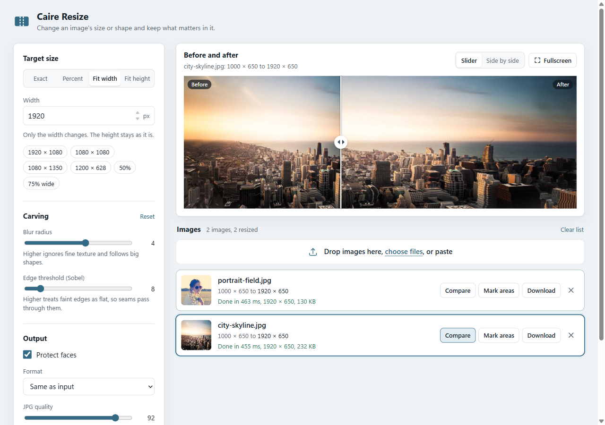

# Caire Resize & Caire Studio

Content-aware image resizing that runs on your own computer. Change a photo's width,
height or aspect ratio and the important parts (people, buildings, faces) keep their
shape, while empty sky, water and plain backgrounds absorb the change.



The project contains two local web apps. Each is a single program with its UI built in:
you start it, and it opens in your browser. Nothing is uploaded to the internet.

| App | What it is for | Speed |
| --- | --- | --- |
| **Caire Resize** (`caire-resize`) | Everyday resizing. Batch of images, presets, before/after slider, ZIP download. | About 0.1 s for a 1000 × 650 photo |
| **Caire Studio** (`caire-studio`) | Exploring how seam carving works. Watch every seam being removed live, tweak every setting of the [caire](https://github.com/esimov/caire) library. | Seconds per image (it is the original library, step by step) |

If you only want to resize images, use **Caire Resize**.

## Quick start

You need [Go 1.22 or newer](https://go.dev/dl/) and a current browser. Then:

```sh
git clone https://github.com/HaiderAli3D/caire-resize.git
cd caire-resize

# Caire Resize (opens http://127.0.0.1:7878)
go run ./resizer

# or Caire Studio (opens http://127.0.0.1:7777)
go run .
```

To get standalone programs you can double-click or copy to another machine:

```sh
go build -o caire-resize.exe ./resizer   # drop .exe on macOS / Linux
go build -o caire-studio.exe .
```

The full setup, including how to install Go, is in
[docs/getting-started.md](docs/getting-started.md).

## Using Caire Resize in 30 seconds

1. Drop one or more images on the page (or click *choose files*, or paste with Ctrl+V).
2. Pick a size: **Exact** (for example 1080 × 1080), **Percent**, **Fit width** or
   **Fit height**, or click a preset.
3. Press **Resize all** (Ctrl+Enter).
4. Drag the divider in **Before and after** to compare, then **Download** one image or
   **Download all (.zip)**.

Want to remove something or keep something safe? Use **Mark areas** on an image and paint
it red (remove first) or green (keep). The full walkthrough, with tips for good results,
is in the [Caire Resize guide](docs/caire-resize.md).

## Documentation

| Guide | Read it when you want to... |
| --- | --- |
| [Getting started](docs/getting-started.md) | Install Go, build and run the apps on Windows, macOS or Linux. |
| [Caire Resize guide](docs/caire-resize.md) | Learn every control of the fast resizer, with tips and its HTTP API. |
| [Caire Studio guide](docs/caire-studio.md) | Use the live seam-carving lab and its HTTP API. |
| [How it works](docs/how-it-works.md) | Understand seam carving, why the fast engine is ~50× faster, and the library patch. |
| [Troubleshooting & FAQ](docs/troubleshooting.md) | Fix common problems and get better-looking results. |
| [Development](docs/development.md) | Run the tests, find your way around the code, make changes. |

## Project layout

```
.
├── resizer/              Caire Resize: server, flags, embedded web UI (resizer/web)
├── internal/fastcarve/   The fast seam-carving engine used by Caire Resize
├── main.go               Caire Studio entry point
├── internal/server/      Caire Studio HTTP API, job runner, live frame streaming
├── web/                  Caire Studio web UI and sample images
├── third_party/caire/    esimov/caire v1.5.0, vendored with a small patch
└── docs/                 Guides and screenshots
```

## Credits

- Seam carving algorithm: Shai Avidan and Ariel Shamir, *Seam Carving for Content-Aware
  Image Resizing* (SIGGRAPH 2007).
- [esimov/caire](https://github.com/esimov/caire) (MIT License) by Endre Simo, vendored in
  `third_party/caire` with its license. Face detection uses
  [esimov/pigo](https://github.com/esimov/pigo) (MIT License).
- Sample photos: see [`web/samples/CREDITS.txt`](web/samples/CREDITS.txt).
