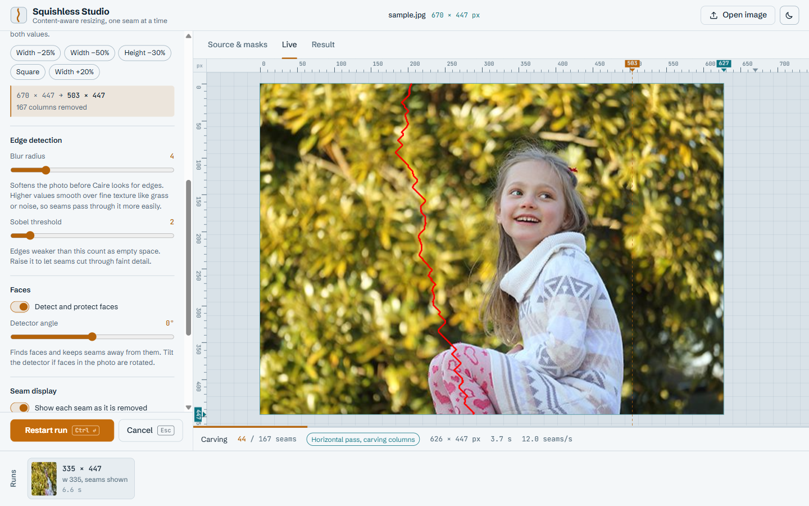

# Squishless Studio guide

Squishless Studio is a lab for [esimov/caire](https://github.com/esimov/caire), the
content-aware image resizer this project is built around. It runs the original library and
streams every carving step to your browser, so you can *see* seam carving work: the image
shrinks or grows one seam at a time while the rulers and counters update.

Use it to learn how the settings affect the result. For day-to-day resizing,
[Squishless](squishless.md) is around 50× faster.

Start it with `go run ./cmd/squishless-studio` or `squishless-studio.exe` (see [Getting started](getting-started.md)).
It opens at <http://127.0.0.1:7777>.



## Feature tour

1. **Source.** Drop a photo anywhere on the page, paste one with Ctrl+V, use
   **Open image**, or click one of the bundled samples. JPEG, PNG, BMP and GIF are
   accepted, up to 25 MB and 40 megapixels.
2. **Target size.** Enter a new width and/or height (leave a side empty to keep it), in
   pixels or as a percentage. Quick presets cover common cases (width -25%, -50%,
   height -30%, square, width +20%). The plan line under the inputs shows the resulting
   size and how many columns or rows will be removed or added. The rulers mark the target
   with an amber guide.
3. **Masks.** On the *Source & masks* tab, paint with the **Protect** brush (green) to
   keep areas intact, or the **Remove** brush (red) to make seams go through them first.
   Use the **Eraser**, `[` and `]` for brush size, *Show* to toggle the overlay, and
   *Clear masks* to start over.
4. **Carve.** Press **Carve image** (Ctrl+Enter). The *Live* tab shows the image changing
   step by step, with rulers for the original, target and current size, plus progress,
   the pass (columns or rows), seams per second and elapsed time. Esc or **Cancel** stops
   the run; **Restart run** starts over with the current settings.
5. **Result.** The *Result* tab shows a draggable before/after comparison (arrow keys move
   the divider too) against the original scaled to the same height, or against a naive
   resize to the same size, which shows what seam carving gained you. **Download** saves
   PNG or JPEG (quality 95).
6. **Runs.** Every finished run lands in the strip at the bottom with a thumbnail and a
   summary of its settings, including any masks. Click one to bring back its settings and
   result.

Light and dark themes follow your system; the button in the header overrides it.

## Settings

| Setting | What it does |
| --- | --- |
| **Width / Height** | Target size in pixels. A side left empty is unchanged. Each side can be at most 10,000 px. |
| **% (percentage)** | The share of the original to **keep**: width 70% gives 70% of the original width. 1-99 only, so percent never enlarges. |
| **Keep aspect while typing** | Fills in the other side to keep the original proportions. |
| **Make square** | Needs a width and a height. The result is a square on the shorter of the two. caire first scales the image so the short side fits, then carves the rest. |
| **Enlarge** | A width or height larger than the source makes caire *insert* seams instead of removing them. Each inserted seam is the average of its neighbours, and recently inserted seams are avoided so the stretch spreads out. |
| **Blur radius** (0-20) | Stack blur applied before edges are measured. Higher values smooth over fine texture (grass, noise) so seams can pass through it. |
| **Sobel threshold** (0-20) | Edges weaker than this count as empty space. Raise it to let seams cut through faint detail. |
| **Detect and protect faces** | Runs the [pigo](https://github.com/esimov/pigo) face detector and gives found faces maximum energy so seams avoid them. A run fails with a clear message if the target is smaller than a detected face. |
| **Detector angle** (-180° to 180°) | Rotation of the face detector, for photos with tilted faces. |
| **Protect mask** | Painted areas count as maximum energy, so seams go around them. |
| **Remove mask** | Painted areas count as zero energy, so seams go through them first. Shrink by about the width of the painted area to remove an object. |
| **Show each seam** | Draws the seam that was just processed on the live stage, as dots or a line, in the chosen color. |

When both sides shrink, caire scales the whole image down to the target aspect ratio first
and carves only the remainder, so fewer seams are carved than the column and row counts
suggest. The plan line says so.

## How the live preview works

`POST /api/jobs` decodes the upload and starts a job. Only one job runs at a time, because
caire keeps state in package variables; starting a new job cancels the previous one.

The job calls caire's `Processor.Run` with two hooks added by this project's patch (see
[How it works](how-it-works.md#the-third_partycaire-patch)):

- `OnStart` reports the effective source size (after any pre-scaling) and the target size,
  which gives the total number of seams.
- `OnFrame` is called after every removed or inserted seam with the current image and the
  seam. Vertical passes work on a rotated image, so `Frame.Upright` turns it back.

The server throttles frames to at most 25 per second, scales them so the long edge is at
most 1000 px, encodes them as JPEG and sends them over Server-Sent Events together with
`progress` events. A browser that connects late gets the latest `start`, `progress` and
`frame` events replayed. When the run ends the stream sends `done` or `error`, and the
browser fetches the full-resolution result. Returning an error from `OnFrame` is how
cancelling stops caire between two seams.

If the stream drops (for example because the server was stopped), the UI shows
*Reconnecting to the server…* and reports a lost connection after 10 seconds.

## HTTP API

All endpoints are on the same origin as the UI. The server only answers requests whose
`Host` is `localhost` or an IP address (to block DNS rebinding), and rejects cross-origin
`POST` requests.

| Method & path | Description |
| --- | --- |
| `GET /api/samples` | JSON list of bundled samples: `name`, `url`, `width`, `height`. |
| `POST /api/jobs` | `multipart/form-data` with `image` (required), optional `mask` and `rmask` (same size as the image; white = painted), and `params` (JSON, below). Returns `{"id", "srcWidth", "srcHeight"}`. Cancels the job that was running. |
| `GET /api/jobs/{id}/events` | SSE stream: `start` (`width`, `height`, `targetWidth`, `targetHeight`, `total`), `progress` (`done`, `total`, `width`, `height`, `pass`, `elapsedMs`), `frame` (base64 `jpeg`, `width`, `height`, `fullWidth`, `fullHeight`, `seams`, `pass`), then `done` (`width`, `height`, `elapsedMs`) or `error` (`error`; `"cancelled"` after a cancel). |
| `GET /api/jobs/{id}/result?format=png\|jpg` | The full-resolution result as an attachment. 409 while running or after a failure. |
| `POST /api/jobs/{id}/cancel` | Cancel a job. Returns 204. |

`params` fields (defaults in brackets): `width`, `height` [0 = unchanged], `percentage`
[false], `square` [false], `blur` [4, 0-50], `sobel` [2, 0-50], `face` [false],
`faceAngle` [0, degrees], `debug` [false, draw seams in frames], `shape` [`"circle"` or
`"line"`], `seamColor` [`"#ff0000"`].

Example:

```sh
curl -F image=@photo.jpg -F 'params={"width":70,"percentage":true}' \
     http://127.0.0.1:7777/api/jobs
```

The server keeps the results of the last 20 successful jobs, within about 512 MB of
decoded pixels (the newest result is always kept). Cancelled and failed jobs are tracked
separately, so restarting runs never pushes results out. If a result is gone, the UI uses
its own copy instead, or removes the history entry when it has none.

## Sample images

The images in `cmd/squishless-studio/web/samples` come from the caire repository (MIT) and from Unsplash via
Lorem Picsum. Credits and licenses are in [`web/samples/CREDITS.txt`](../cmd/squishless-studio/web/samples/CREDITS.txt).
