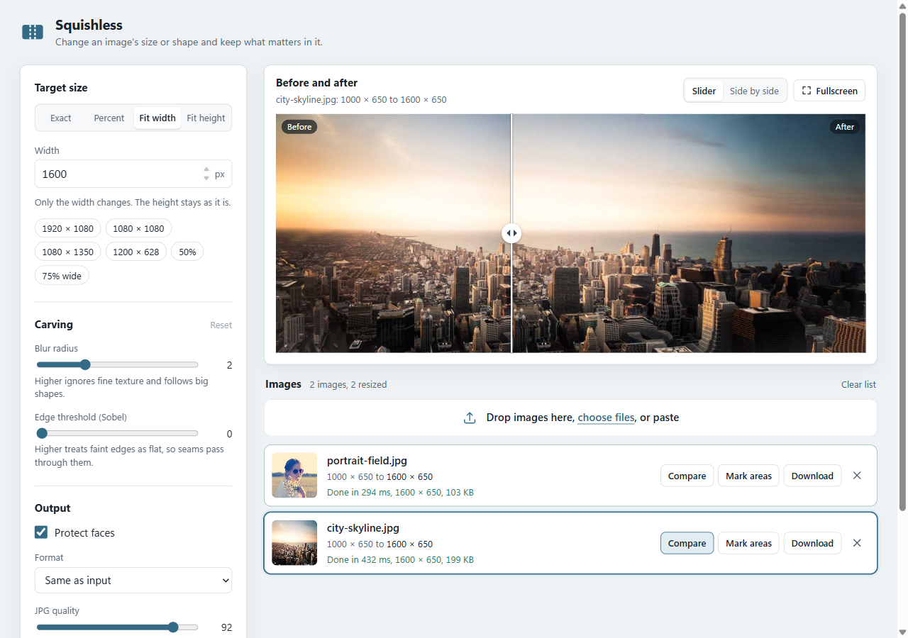
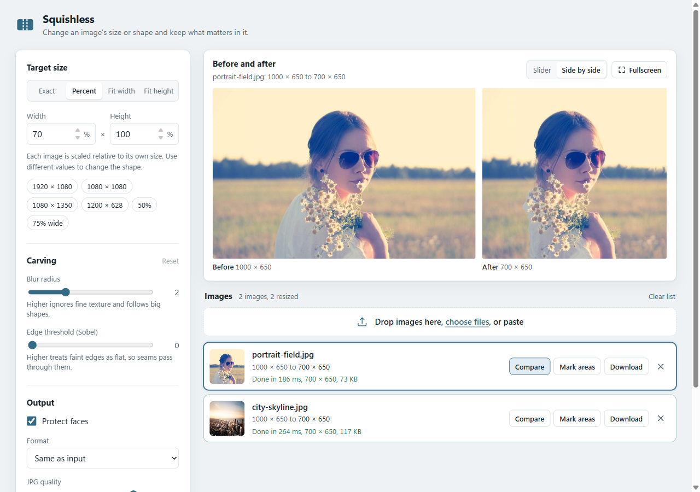
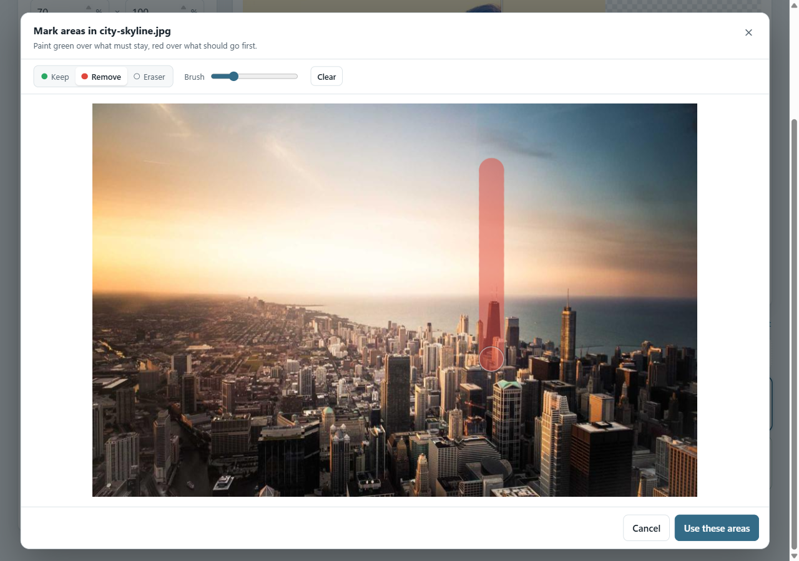

# Squishless guide

Squishless changes the size or shape of your images with **seam carving**. Instead of
squashing the whole picture (plain resize) or cutting off the edges (crop), it removes or
duplicates thin, low-detail paths of pixels. The subject keeps its proportions; the
background gives way.

Start it with `go run ./cmd/squishless` or by running `squishless.exe` (see
[Getting started](getting-started.md)). It opens at <http://127.0.0.1:7878>.



## The basic workflow

1. **Add images.** Drop files anywhere on the *Images* area, click **choose files**, or
   paste an image from the clipboard (Ctrl+V / ⌘V). JPEG, PNG, GIF, BMP and WebP are
   accepted, up to 30 MB and 50 megapixels per image. You can add many at once.
2. **Choose the target size** in the *Target size* panel (see below).
3. Press **Resize all** or **Ctrl+Enter**. Images are processed two at a time; each row
   shows its progress and then the result size, the time it took and the file size.
4. **Check the result** in the *Before and after* panel at the top.
5. **Download** a single image from its row, or **Download all (.zip)** for every finished
   image. Files are named `originalname-WIDTHxHEIGHT.jpg` (or `.png`).

The settings you choose are remembered the next time you open the app.

## Target size

Pick one of four modes with the tabs:

| Mode | What you enter | What happens to each image |
| --- | --- | --- |
| **Exact** | Width and height in pixels | Every image becomes exactly that size. Use it for fixed formats (a 1080 × 1080 post, a 1920 × 1080 wallpaper). |
| **Percent** | Width % and height % | Each image is scaled relative to *its own* size. 50% × 50% halves everything; 70% × 100% makes images narrower but keeps their height. Allowed range: 10-400%. |
| **Fit width** | A width in pixels | Only the width changes; the height stays as it is. |
| **Fit height** | A height in pixels | Only the height changes; the width stays as it is. |

**Presets** fill in common sizes with one click: 1920 × 1080 (HD / widescreen),
1080 × 1080 (square post), 1080 × 1350 (portrait post), 1200 × 628 (link preview),
50%, and 75% wide.

**Limits:** a side can grow to at most 4× the original, and the result can be at most
50 megapixels. A row shows the reason if a target is out of range.

### Shrinking, growing and changing the shape

- **Make it narrower or shorter** (one side smaller): this is where seam carving shines.
  Low-detail columns or rows are removed one by one.
- **Make it wider or taller** (one side bigger): seams are duplicated instead. The
  stretch is spread across the flattest areas, so a landscape gets wider without
  stretching the buildings in it. Very large enlargements (more than about 1.5×) start to
  show repeated textures.
- **Both sides smaller (or both bigger):** the image is first scaled uniformly (like a
  normal resize, no distortion) until one side matches, and only the leftover difference
  is carved. This keeps the result natural. For example, 1000 × 650 to 500 × 500 first
  scales to 769 × 500 and then carves away 269 columns.

## Before and after

When an image finishes, the **Before and after** panel shows it automatically. Click
**Compare** on any finished row to show that image instead (the selected row is
outlined).

- **Slider view:** drag anywhere on the picture to move the divider. With the divider
  focused, use the arrow keys (Shift for bigger steps), Page Up/Down, Home and End.
- **Side by side:** the original and the result next to each other at the same scale, so
  you can see the size difference.
- **Fullscreen:** a larger view with its own Download button. Press Esc to close.

If you change a setting after resizing, the row says *Settings changed, resize again* and
the panel notes *Made with earlier settings*. Press **Resize all** again to update.



## Mark areas: keep or remove things

Click **Mark areas** on an image to paint directly on it.



| Brush | Color | Effect |
| --- | --- | --- |
| **Keep** | Green | Seams never pass through it. Use it on people, logos, text, anything that must not be distorted. |
| **Remove** | Red | Seams go through it first, so it disappears as the image shrinks. |
| **Eraser** | | Removes paint. |

Use the **Brush** slider to change its size, **Clear** to start over, and **Use these
areas** to save. Each image has its own marks, and its row shows *Keep areas*,
*Remove areas* or both.

**Removing an object (for example a person or a pole):**

1. Paint the object red, a little wider than the object itself.
2. Paint anything nearby you want to keep green.
3. Use **Fit width** and reduce the width by at least the width of the red area (if the
   object is 120 px wide, remove 130-150 px).
4. Resize and check with the slider.

Tall objects are removed by reducing the width; wide objects (a power line) by reducing
the height. Removal only happens when the image shrinks in that direction; the red marks
are ignored when an image is enlarged.

## Carving settings

These control how the app decides what is "important". The defaults work for most photos;
**Reset** restores them.

| Setting | Range (default) | What it does | When to change it |
| --- | --- | --- | --- |
| **Blur radius** | 0-7 (2) | Blurs the picture before looking for edges. Higher values ignore fine texture (grass, leaves, noise, fabric) and follow big shapes. | Raise it if seams avoid busy textures and cut through the subject instead. Lower it (0-1) for graphics, text and clean illustrations. |
| **Edge threshold (Sobel)** | 0-64 (0) | Edges weaker than this count as flat, so seams may pass through them. | Raise it (10-30) when faint background detail (clouds, gradients, light texture) is being kept at the expense of the subject. Keep it low when the image has subtle but important detail. |

Changing these is cheap: the time per image stays roughly the same (about 0.1-0.15 s for
a 1000 × 650 photo).

## Output settings

| Setting | Meaning |
| --- | --- |
| **Protect faces** (on by default) | Detects faces and protects them like a green mark. It finds frontal faces; faces in profile or behind large sunglasses can be missed, so paint those green yourself. |
| **Format** | *Same as input* keeps JPEG as JPEG and saves everything else as PNG. Or force **JPG** or **PNG**. |
| **JPG quality** | 40-100 (92). Higher means larger files and fewer compression artifacts. Only used for JPG output. |

## Tips for good results

- **Seam carving needs somewhere to hide the change.** Sky, water, walls, grass and
  out-of-focus backgrounds are perfect. A frame filled edge to edge with detail (a crowd,
  a dense city) will always show some distortion; consider a normal crop instead.
- **Keep changes moderate.** Removing up to about 30-40% of one side usually looks
  natural. Beyond that, combine with a crop or let the app scale first by changing both
  sides.
- **Protect straight lines.** Horizons, roads and building edges can bend if seams run
  through them. A green stroke along the line fixes it.
- **Compare before downloading.** The slider is the quickest way to spot a bent line or
  a squeezed face.

## Keyboard shortcuts

| Keys | Action |
| --- | --- |
| Ctrl+Enter (⌘+Enter) | Resize all |
| Ctrl+V (⌘+V) | Paste an image from the clipboard |
| Arrow keys, Shift+Arrow, Home, End | Move the before/after divider (when focused) |
| Arrow keys | Switch size-mode tabs, brushes and view toggles |
| Esc | Close the fullscreen view or the Mark areas dialog |

## HTTP API

The UI talks to one endpoint, which you can use from scripts too.

`POST /api/resize` with `multipart/form-data`:

| Field | Required | Value |
| --- | --- | --- |
| `image` | yes | The image file (max 30 MB, 50 MP). |
| `width`, `height` | at least one | Target size in px. `0` or missing keeps that side. At most 4× the original. |
| `faces` | no | `1` to protect faces, `0` (default) not to. |
| `blur` | no | Blur radius 0-7 (default 2). |
| `sobel` | no | Edge threshold 0-64 (default 0). |
| `format` | no | `same` (default), `jpg` or `png`. |
| `quality` | no | JPG quality 1-100 (default 92). |
| `protect`, `remove` | no | Mask images the same size as `image`; white (> 127) marks the area. |

The response is the resized image as an attachment, with headers `X-Width`, `X-Height`
and `X-Elapsed-Ms`. Errors return JSON `{"error": "..."}` with status 400, 413 or 500.
The server resizes up to half your CPU cores' worth of images at a time and makes other
requests wait.

Example:

```sh
curl -F image=@photo.jpg -F width=800 -F faces=1 -o photo-800.jpg \
     http://127.0.0.1:7878/api/resize
```

Resize a whole folder (bash):

```sh
mkdir -p out
for f in *.jpg; do
  curl -s -F image=@"$f" -F width=1080 -F height=1080 -F faces=1 \
       -o "out/$f" http://127.0.0.1:7878/api/resize
done
```
